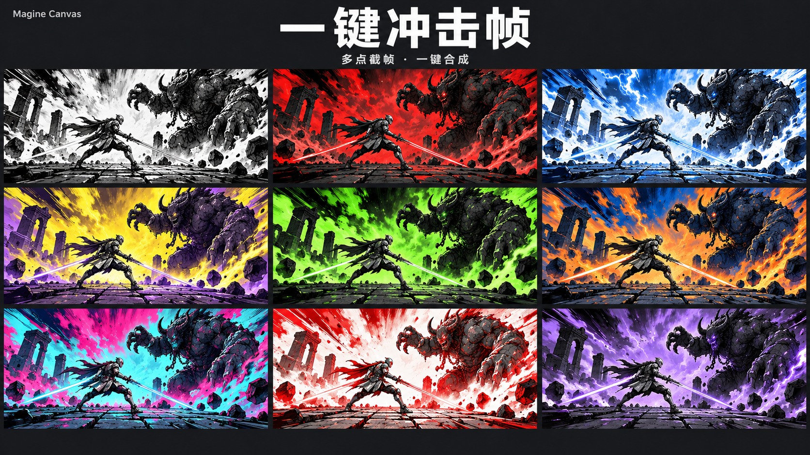
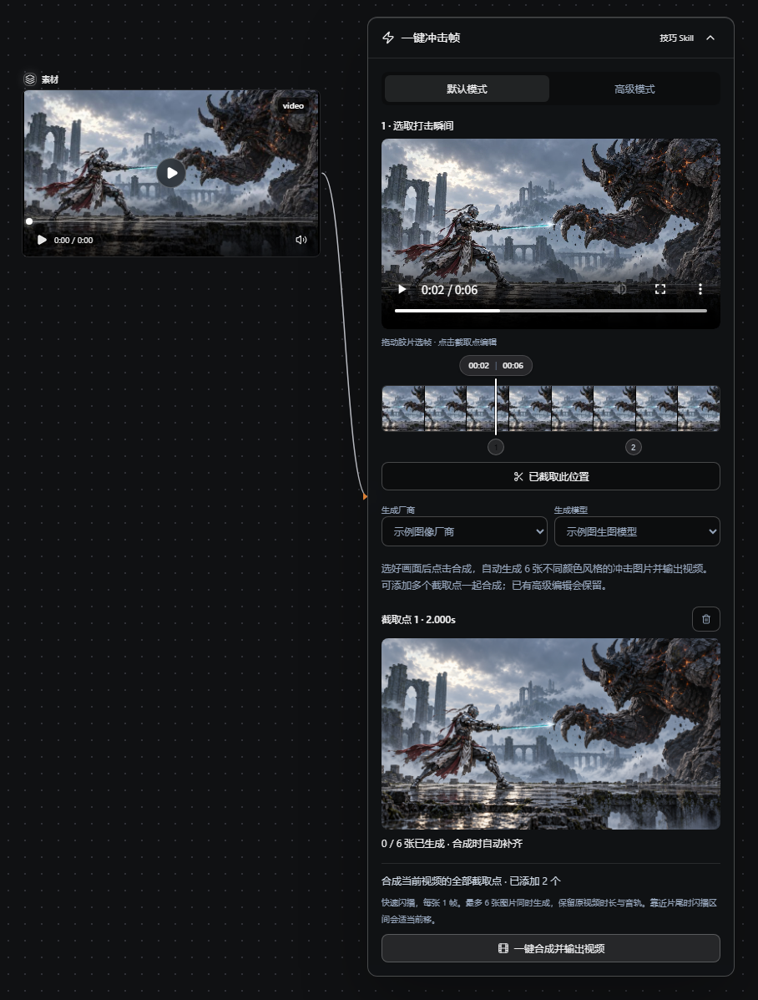
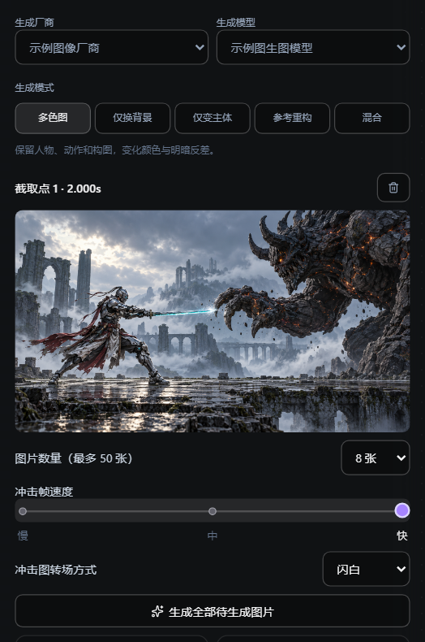
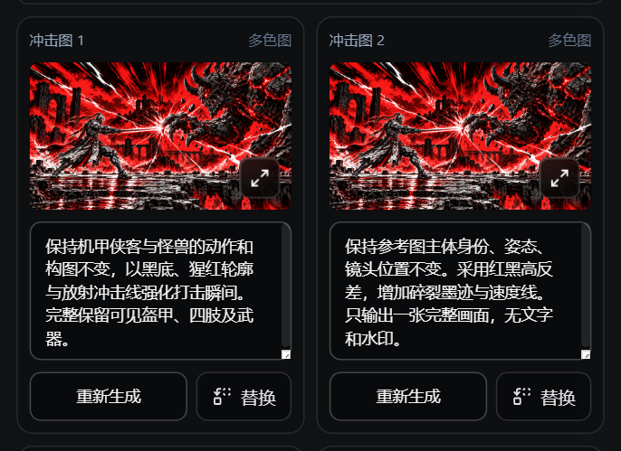
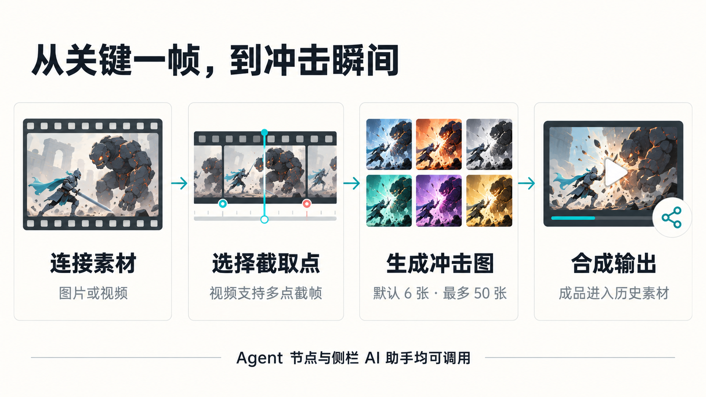

> 本文介绍 MAGINE Canvas 宿主中的完整操作界面。开源包的独立运行方式见 [README](../README.md)；画布接入源码需要自行实现宿主服务。

# 把打击感做进关键一帧：Magine Canvas「一键冲击帧」使用指南

同样是一次挥剑、一次碰撞，为什么有的画面看起来格外有力量？

除了动作与音效，关键瞬间的视觉变化也很重要：画面短暂切换成黑白剪影、红黑爆闪或蓝橙反差，随后回到原来的镜头。几张快速闪过的图，就能让观众更清楚地感受到“这一击”。

Magine Canvas 的**【一键冲击帧】多点截帧·一键合成**，把取帧、参考图生成和闪播合成放进了同一个技巧 Skill 节点。你负责选中想强调的瞬间，它负责把后续步骤连接起来。

*图 1｜九格展示不同色彩风格，属于效果示意。默认新建截取点生成 6 张图片，高级模式可自行调整数量。*

**01　冲击帧，改变的是哪一瞬间？**

可以把这套流程理解为：从视频中取出一张关键画面，以它为参考生成一组冲击图，再让这些图片在选定位置快速闪播，最后合成完整视频。

例如，在“机甲侠客与巨魔交锋”的镜头里，选择剑锋与利爪接触的瞬间，让画面短暂进入高反差的冲击状态，再继续播放后面的动作。视频的原总时长与音轨会保留，闪播区间之外的内容也会保留。

它适合用来强调打斗中的接触点、招式爆发、变身亮相，或其他需要突出节奏的瞬间。第一次使用，可以先做一个点，看看闪播长度与镜头节奏是否合适，再逐步增加变化。

**02　第一次使用：默认模式，五步完成**

**第一步：添加 Skill。**
打开画布的 Skill 列表，在“技巧skill”分类中找到 **【一键冲击帧】多点截帧·一键合成**，点击卡片上的加号，将节点放到画布中。

**第二步：连接素材。**
把视频节点的输出点，连到一键冲击帧节点左侧的输入点。上传的视频和画布生成的视频都可以使用，前提是原视频能够正常读取。

**第三步：选择厂商和模型。**
在节点里先选择“生成厂商”，再选择对应的“生成模型”。这里需要的是已配置、支持参考图片输入的图像生成模型。冲击图的数量会影响生成请求量，实际费用以所选厂商和模型为准。

如果列表显示“暂无可用厂商”或“暂无可用图生图模型”，请先到 API 配置中启用并配置支持参考图片的图像厂商，再回到节点选择。

**第四步：找到打击瞬间。**
在节点的胶片时间轨上拖动标线，对照预览画面，找到最想强调的一帧。点击“添加截取点”即可保存这个位置；如果已经截取，按钮会显示“已截取此位置”。

**第五步：一键合成。**
保持“默认模式”，点击 **“一键合成并输出视频”**。对于新建的截取点，系统会默认生成 6 张不同颜色风格的冲击图，并以快档、直切方式自动合成。

只做一个点时，也可以选好时间后直接点击合成，系统会截取当前游标所在的画面。

*图 2｜当前界面组件与演示素材：左侧视频连接到 Skill，时间轨上显示两个截取点。为便于教学，节点滚动区域已展开。示例厂商和模型不代表固定配置。*

生成时，节点和处理按钮会显示进度，最多支持 **6 张冲击图同时生成**，更多图片会继续排队。完成后，画布上会出现与 Skill 连线的“冲击帧成品”视频素材。

每次成功合成也会写入**历史素材**。如果希望收到完成通知，可以开启“生成成功提醒”，并通过提醒定位到对应成品。

**03　一段视频，可以设置多个冲击点**

如果一段动作里有两次交锋，就不必拆成两个独立任务。

例如，分别在第 2 秒和第 4.4 秒找到合适画面，每次点击“添加截取点”。时间轨会显示对应的标记，方便你查看已经选了哪些位置。添加完最后一个点后，保持游标位置，再点击默认模式的合成按钮，就能一起处理当前视频的全部截取点。

点击时间轨上的某个截取点，还能打开它的高级编辑面板。每个点可以有自己的图片数量、生成模式、速度和转场。

需要注意的是，**截取点之间要给闪播留出空间**。图片越多、速度越慢，或使用了需要额外时间的转场，效果占用的区间就越长。如果提示时间重叠，可以拉开截取点、减少图片数量，或加快速度。

**04　高级模式：把每一组冲击图调成你想要的样子**

切换到“高级模式”后，每个截取点支持 **1–50 张图片**。可以先用少量图片试出感觉，再增加数量，让生成次数与实际需要匹配。

生成厂商和模型下方有五种模式：

| 模式 | 会怎样变化 |
| --- | --- |
| 多色图 | 保持人物、动作和构图，改变颜色、明暗反差与冲击风格。 |
| 仅换背景 | 保留画面中央的完整主体；其他人物、物体作为背景处理。 |
| 仅变主体 | 只改变中央主体的服装、装备、材质和特效，保留其身份与样貌；背景和其他人物、物体保持不变。 |
| 参考重构 | 保持人物身份、样貌以及主体与背景的构图关系，重新设计服装装备与背景环境。 |
| 混合 | 多选基础模式，让每张冲击图随机使用其中一种，整组形成不同变化。 |

“混合”是让一组图片使用不同模式。例如，同时选择“多色图”和“仅换背景”，一部分图片进行色彩变化，另一部分重新设计背景。

对于“仅换背景”和“仅变主体”，生图提示词会重点强调中央完整主体，保护原图中可见的肢体、服装、装备与附属物，避免误抠和遗漏。当前流程不额外调用大模型审核，效果仍取决于参考图和所选模型，生成后可以放大检查并调整。

*图 3｜高级模式参数示例：每个截取点最多 50 张；速度通过“慢—中—快”三挡滑杆选择。图中当前选择 8 张、快档和闪白转场。*

**速度与转场，决定闪播的节奏。**

速度滑杆有“慢、中、快”三挡。想要短促、利落的打击感，可以先从快档开始；希望观众有更多时间看清图像变化，可以尝试中档或慢档。

转场支持四种选择：**直切、叠化渐变、闪黑、闪白**。直切的切换更干脆；叠化渐变让相邻图片逐步过渡；闪黑和闪白则在图片之间增加黑场或白场的节奏变化。

**手动操作高级模式时，要先生成图片，再合成视频。**
“生成全部待生成图片”只处理当前截取点。视频有多个点时，需要分别打开各点，完成其中的冲击图；全部就绪后，再点击“合成全部截取点并输出”。

**05　某张不满意？单独改，不用整组重来**

每张冲击图都有独立的提示词框。你可以修改描述，再点击“生成图片”或“重新生成”，也可以连续启动多张图片的生成任务。

例如，想强化红黑爆闪，可以写：

> 保持参考画面的主体身份、动作与构图不变。采用黑底、猩红轮廓和放射状冲击线，强调武器接触的瞬间。完整保留可见肢体与装备，只输出一张画面，无文字、无水印。

已有满意的图片，还可以点击**“替换”**，从画布或本机选择图片。图片右下角的放大按钮，可以帮助你检查主体边缘、手部和装备细节。

*图 4｜单图编辑界面演示。图中冲击图为文章配图素材，用来说明提示词、重新生成、替换与放大入口。*

切换生成模式会保留已有图片。若希望某张已完成的图片采用新模式，需要对它重新生成或替换；回到默认模式，也会保留此前的高级编辑。

如果部分图片失败，已成功的图片和原素材连线会保留，可以先检查模型与报错，再重试失败部分。

**06　只有一张图片，也能做冲击帧**

一键冲击帧也支持图片输入。

把图片节点连接进来后，系统会直接使用原图作为参考，不需要在时间轨上截帧。默认模式可以自动生成并合成；高级模式则可以调整数量、生成模式、速度与转场，输出一段独立的冲击帧短视频。

这适合把一张已经确定构图的角色图、战斗插画或关键画面，制作成短促的视觉强调片段。

*图 5｜流程示意。图片输入跳过截帧；默认模式可以自动衔接生成与合成，手动高级模式则需先完成各点的图片，再合成。*

从一个清楚的动作接触点开始，先试默认的 6 张快闪，预览后再决定是否增加颜色、模式或转场。把冲击效果放在真正需要强调的位置，画面的节奏才更有层次。
